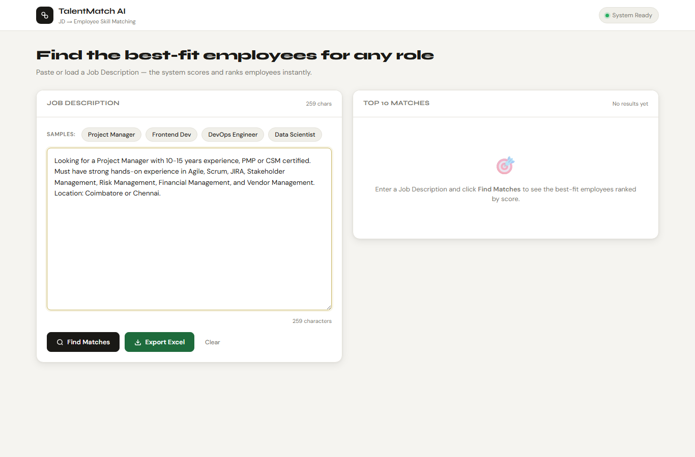
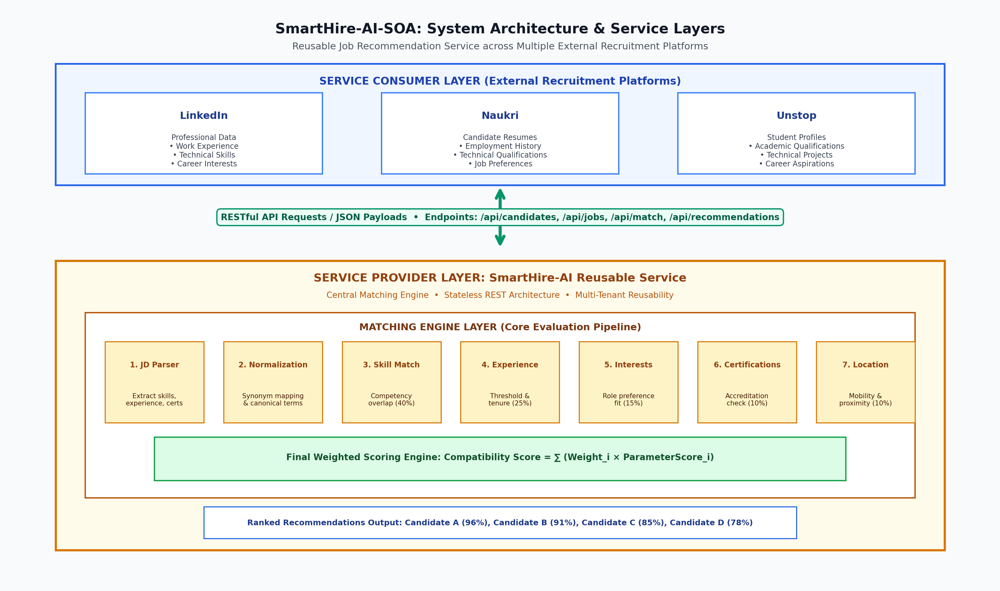
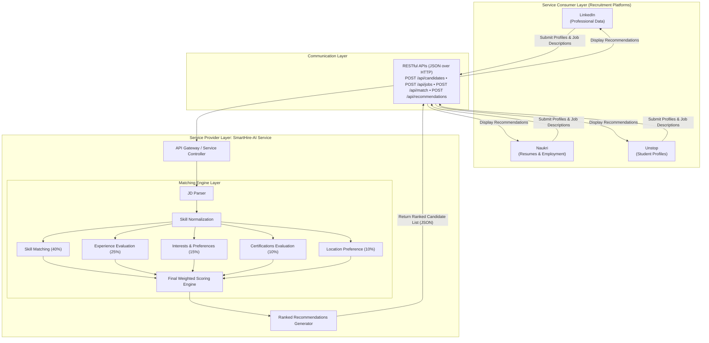
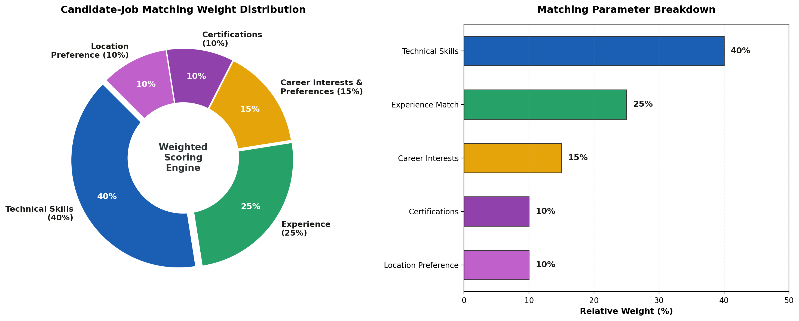
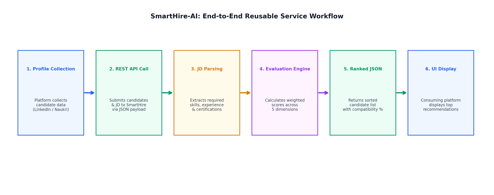

## TASK 3 – SERVICE ORIENTED ARCHITECTURE
### TANIKASRI S (RA2311003050073)
### NANDITHA M S (RA2311003050101)
### SHIBANI B (RA2311003050097)

# SmartHire-AI-SOA
### Job Recommendation as a Service Using Service-Oriented Architecture

<p align="center">
  <b>One Intelligent Matching Service. Multiple Recruitment Platforms. Smarter Job Recommendations.</b>
</p>

---

## 1. Project Overview

**SmartHire-AI-SOA** is a proposed AI-powered job recommendation service designed using **Service-Oriented Architecture (SOA)**.

The objective is to develop a centralized and reusable job-matching service that can be integrated into multiple recruitment platforms such as LinkedIn, Naukri, and Unstop.

Every recruitment platform maintains its own candidate database containing information such as resumes, technical skills, educational qualifications, work experience, certifications, and career interests.

Instead of developing individual matching algorithms, these platforms can consume the SmartHire-AI service through standardized REST APIs.

The service evaluates candidate profiles against job descriptions, calculates compatibility scores, and generates ranked recommendations from highest to lowest suitability.

**Core Concept:** Providing intelligent candidate-job matching as a reusable service that can be consumed by different external applications.

<p align="center">
  
  <br/>
  <em>Figure 1: SmartHire interactive web application dashboard displaying real-time JD parsing and candidate ranking preview.</em>
</p>

---

## 2. Problem Statement

Recruitment platforms need efficient mechanisms to connect suitable candidates with relevant job opportunities.

Developing separate recommendation systems for every platform can lead to:

- Duplication of matching algorithms.
- Increased development and maintenance costs.
- Limited interoperability between applications.
- Inconsistent candidate evaluation methods.
- Difficulty integrating intelligent recommendation capabilities into existing systems.

SmartHire-AI addresses this architectural challenge through a centralized service that provides reusable candidate-job matching functionality.

---

## 3. Proposed Solution

SmartHire-AI acts as an independent service provider that exposes candidate-job matching functionality through RESTful APIs.

External recruitment applications can submit candidate information and job descriptions to the service.

The matching engine evaluates candidate profiles using multiple parameters and generates a ranked list of suitable candidates.

The service is designed to operate independently of individual recruitment platforms.

### Example Use Case

Consider a company hiring a **Java Full Stack Developer**.

**Job Requirements:**
- Java
- Spring Boot
- React
- SQL
- Relevant experience

Different recruitment platforms can submit their candidate profiles to SmartHire-AI. The service evaluates each candidate and returns ranked recommendations.

| Candidate | Matching Score | Rank |
|---|---:|---:|
| Candidate A | 96% | 1 |
| Candidate B | 91% | 2 |
| Candidate C | 85% | 3 |
| Candidate D | 78% | 4 |

*Illustrative results representing the proposed matching workflow.*

The consuming application can display these recommendations to recruiters or job seekers.

---

## 4. System Architecture

The proposed system consists of three major architectural layers:

<p align="center">
  
  <br/>
  <em>Figure 2: Three-tier Service-Oriented Architecture connecting external consumer platforms to the central SmartHire-AI service.</em>
</p>

### A. Service Consumer Layer

Multiple recruitment applications act as service consumers:

- **LinkedIn**: Professional information, technical skills, work experience, career interests.
- **Naukri**: Candidate resumes, employment information, technical qualifications, job preferences.
- **Unstop**: Student profiles, academic information, technical skills, career interests.

Each platform communicates with SmartHire-AI through standardized API requests, subject to appropriate authorization and data-sharing permissions.

### B. Service Provider Layer

SmartHire-AI acts as the centralized service provider. Its responsibilities include:

- Receiving candidate profile information.
- Processing job descriptions.
- Extracting and normalizing skills.
- Evaluating candidate suitability.
- Calculating weighted compatibility scores.
- Generating ranked recommendations.
- Returning results to consuming applications.

### C. Matching Engine Layer

The matching engine contains reusable evaluation components:

1. **Job Description Parser**: Extracts required skills, minimum experience, and qualifications from unstructured JD text.
2. **Skill Normalization**: Maps synonyms into canonical industry terminology.
3. **Skill Matching**: Calculates technical competency overlap.
4. **Experience Evaluation**: Measures candidate tenure against role seniority thresholds.
5. **Certification Evaluation**: Validates industry-recognized accreditations.
6. **Interest and Preference Matching**: Aligns candidate career goals with role profiles.
7. **Final Weighted Scoring Engine**: Synthesizes multi-attribute scores into a normalized compatibility rating.



---

## 5. Service-Oriented Architecture Principles

The proposed system adheres to core SOA principles:

| SOA Principle | Application in SmartHire-AI |
|---|---|
| **Loose Coupling** | External platforms communicate without depending on internal matching logic. |
| **Reusability** | The same matching service supports multiple recruitment applications simultaneously. |
| **Interoperability** | Applications communicate through open, standard HTTP and JSON formats. |
| **Service Contract** | REST API endpoints define a formal, platform-independent communication interface. |
| **Service Autonomy** | Matching functionality operates independently of individual consuming platforms. |
| **Discoverability** | API documentation explicitly describes available service operations and schemas. |

**Architecture Objective:** A single centralized matching service consumed by multiple independent applications.

---

## 6. Candidate Matching Methodology

The proposed matching engine evaluates candidates using a multi-parameter weighted scoring approach:

<p align="center">
  
  <br/>
  <em>Figure 3: Multi-parameter weighted scoring model distribution for candidate-job compatibility evaluation.</em>
</p>

| Matching Parameter | Weight | Description |
|---|---:|:---|
| **Technical Skill Matching** | **40%** | Overlap between normalized candidate competencies and required skills |
| **Experience Matching** | **25%** | Candidate tenure alignment against minimum required experience |
| **Career Interests and Role Preferences** | **15%** | Alignment with candidate career trajectory and domain interests |
| **Certifications** | **10%** | Value-added professional certifications and accreditations |
| **Location Preference** | **10%** | Proximity match or candidate readiness to relocate |
| **Total** | **100%** | Normalized composite compatibility score |

### Weighted Scoring Formula

$$\text{Final Compatibility Score} = (0.40 \times \text{Skill}) + (0.25 \times \text{Exp}) + (0.15 \times \text{Interest}) + (0.10 \times \text{Cert}) + (0.10 \times \text{Location})$$

Each parameter is normalized between $0$ and $100$. The final composite scores are used to rank candidates in descending order of compatibility.

---

## 7. Service Communication and API Design

The proposed service exposes RESTful endpoints for communication with external recruitment applications:

| HTTP Method | Endpoint | Purpose | Status |
|---|---|---|---|
| `POST` | `/api/candidates` | Submit candidate profile information | Proposed |
| `POST` | `/api/jobs` | Submit job description information | Proposed |
| `POST` | `/api/match` | Evaluate candidate-job compatibility | Proposed |
| `POST` | `/api/recommendations` | Generate ranked candidate recommendations | Proposed |
| `GET` | `/api/health` | Check service availability and status | Proposed |
| `POST` | `/api/get_matches` | Free-text JD matching against bench dataset | Implemented |
| `POST` | `/api/generate_excel` | Export candidate matching report as `.xlsx` | Implemented |

### Sample Candidate Request (`POST /api/candidates`)

```json
{
  "candidate_id": "C101",
  "skills": ["Java", "Spring Boot", "React", "SQL"],
  "experience": 1,
  "certifications": ["AWS Cloud Practitioner"],
  "interests": ["Backend Development"],
  "preferred_location": "Chennai",
  "preferred_role": "Java Developer"
}
```

### Sample Job Description Request (`POST /api/jobs`)

```json
{
  "job_id": "J101",
  "title": "Java Full Stack Developer",
  "required_skills": ["Java", "Spring Boot", "React", "SQL"],
  "min_experience": 1,
  "location": "Chennai"
}
```

### Sample Service Response (`POST /api/recommendations`)

```json
{
  "job_id": "J101",
  "recommendations": [
    {
      "candidate_id": "C101",
      "match_score": 96,
      "rank": 1
    },
    {
      "candidate_id": "C102",
      "match_score": 89,
      "rank": 2
    }
  ]
}
```

*The above endpoints and JSON payloads describe the proposed service interface, demonstrating contract-first SOA design.*

---

## 8. Technology Stack

| Category | Technology | Description |
|---|---|---|
| **Programming Language** | Python 3.x | Core runtime for backend and matching algorithms |
| **Backend Framework** | Flask | Lightweight WSGI web framework and API provider |
| **API Communication** | REST APIs | Standardized stateless HTTP communication |
| **Data Exchange** | JSON | Lightweight, language-agnostic data format |
| **Matching Methodology** | Weighted Scoring | Multi-criteria mathematical evaluation engine |
| **Data Processing** | Pandas, NumPy | High-performance in-memory tabular data operations |
| **Data Storage / Export** | Excel (`openpyxl`) | Dataset storage and audit report generation |
| **Frontend** | HTML5, CSS3, JavaScript | Interactive web dashboard with real-time preview |
| **API Testing** | Postman | Verification of service contracts and endpoints |
| **Version Control** | Git & GitHub | Source code tracking and collaborative version control |

---

## 9. Proposed Service Workflow

<p align="center">
  
  <br/>
  <em>Figure 4: End-to-end service execution workflow from platform data submission to recommendation delivery.</em>
</p>

1. **Profile Ingestion**: An external recruitment platform collects candidate information through its application.
2. **Authorized Dispatch**: The platform submits candidate data to the SmartHire-AI service via REST API (`POST /api/match`).
3. **Requirement Reception**: The service receives the candidate profiles and target job description.
4. **JD Parsing**: The parser extracts required technical skills, experience bounds, and certifications.
5. **Multi-Parameter Evaluation**: The matching engine evaluates candidates across skills, tenure, interests, credentials, and mobility.
6. **Weighted Scoring**: The scoring mechanism computes normalized compatibility scores ($0\text{--}100\%$).
7. **Ranking & Sorting**: Candidates are sorted in descending order of matching compatibility.
8. **JSON Dispatch**: The service returns structured JSON recommendations to the consuming platform.
9. **Display Presentation**: The external application renders the shortlisted candidate recommendations on recruiter dashboards.

---

## 10. Advantages

- **Reusable Matching Logic**: Eliminates duplicate development of recommendation algorithms across different platforms.
- **Loose Coupling**: Consuming platforms remain completely independent of the internal matching implementation.
- **Centralized Quality**: Refinements to evaluation weights immediately upgrade matching quality across all consumer platforms.
- **Standardized Interoperability**: Clean REST/JSON contracts allow seamless integration with web, desktop, and mobile clients.
- **Platform Independence**: Can be consumed by Python, JavaScript, Java, PHP, or .NET backends.
- **High Scalability**: The stateless service can be containerized and scaled horizontally to accommodate high peak hiring volumes.

---

## 11. Future Enhancements

- **Authorized Partner APIs**: Production integration with partner platform APIs (LinkedIn Talent Solutions, Naukri Enterprise).
- **OAuth 2.0 Security**: Token-based authentication and rate limiting for secure multi-tenant service consumption.
- **Semantic NLP Matching**: Deep learning embeddings (BERT, SpaCy) for conceptual skill matching beyond exact keyword matching.
- **Automated Resume Parsing**: OCR and PDF parsing to automatically extract candidate parameters from unstructured resumes.
- **Cloud Microservice Deployment**: Packaging with Docker and deploying to AWS ECS or Google Cloud Run with autoscaling.

---

## 12. Conclusion

**SmartHire-AI-SOA** presents a reusable job recommendation service based on Service-Oriented Architecture.

By decoupling candidate-job matching functionality from individual recruitment applications, the architecture enables multiple platforms (LinkedIn, Naukri, Unstop) to consume a single centralized intelligent matching service through standardized REST APIs.

The system provides a robust architectural foundation for building interoperable, reusable, and scalable talent matching solutions.

<p align="center">
  <b>SmartHire-AI – One Matching Engine, Multiple Recruitment Platforms, Smarter Recommendations.</b>
</p>

---

## Project Information

| Attribute | Details |
|---|---|
| **Project Name** | SmartHire-AI-SOA |
| **Domain** | Service-Oriented Architecture (SOA) |
| **Application Area** | Recruitment and Job Recommendations |
| **Backend** | Python Flask |
| **Communication** | REST APIs (JSON over HTTP) |
| **Version Control** | GitHub |

## Team Members

1. **Nanditha M S** (RA2311003050101)
2. **Tanikasri S** (RA2311003050073)
3. **Shibani B** (RA2311003050097)

**Academic Project – Service-Oriented Architecture (Task 3)**
